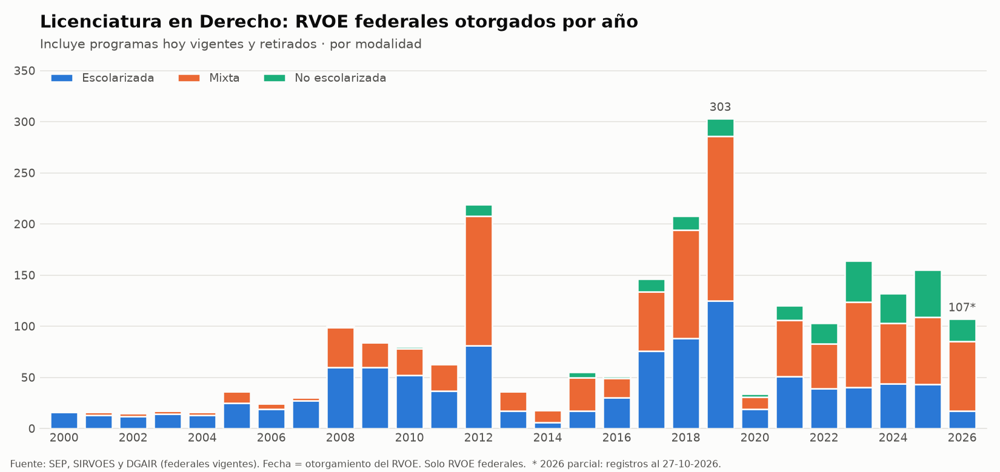

# RVOEs de educación superior en México

Base de datos abierta de los **Reconocimientos de Validez Oficial de Estudios (RVOE) federales del tipo superior**. Se construye a partir de las dos fuentes públicas de la SEP y se cruzan entre sí.

- **46,446 programas** en la tabla unificada: 39,907 vigentes y 6,539 retirados.
- **2,470 nombres de institución** distintos con programas vigentes y **3,432 planteles** en SIRVOES.
- Corte: registros con fecha de otorgamiento hasta el **27-10-2026** (descarga del 25-11-2026).



---

## Contenido

1. [Archivos](#archivos)
2. [Fuentes](#fuentes)
3. [Qué aporta cada fuente](#qué-aporta-cada-fuente)
4. [Cómo se construye la tabla unificada](#cómo-se-construye-la-tabla-unificada)
5. [Diccionario de datos](#diccionario-de-datos)
6. [Hallazgos del cruce](#hallazgos-del-cruce)
7. [Panorama general](#panorama-general)
8. [Caso: Licenciatura en Derecho](#caso-licenciatura-en-derecho)
9. [Limitaciones y advertencias](#limitaciones-y-advertencias)
10. [Reproducir](#reproducir)

---

## Archivos

| Archivo | Qué es | Filas |
|---|---|---|
| **`data/rvoes.csv`** / **`.xlsx`** | **Tabla unificada (usar esta).** Todo SIRVOES más los RVOE vigentes que solo aparecen en DGAIR | 46,446 |
| `data/rvoes_sirvoes.csv` / `.xlsx` | Todos los programas de SIRVOES, vigentes y retirados, con datos del plantel | 43,156 |
| `data/rvoes_dgair.csv` / `.xlsx` | Tablas extraídas de los 5 PDFs de federales vigentes de DGAIR | 41,342 |
| `data/cruce_dgair_sirvoes.csv` | Tabla DGAIR con el estatus que cada RVOE tiene en SIRVOES | 41,342 |
| `img/derecho_por_anio.png` | Gráfica de la Licenciatura en Derecho | — |
| `parse_dgair.py` | Extrae las tablas de los PDFs (pdfplumber) | |
| `scrape_sirvoes.py` | Descarga SIRVOES desde su API JSON | |
| `cruce.py` | Cruza ambas fuentes y genera la tabla unificada | |
| `grafica_derecho.py` | Genera la gráfica y su tabla | |

Los CSV están en UTF-8 con BOM, así que Excel los abre con acentos correctos. Las fechas están en formato `AAAA-MM-DD`.

---

## Fuentes

### 1. DGAIR: Instituciones federales vigentes
<https://dgair.sep.gob.mx/federales_vigentes>

La Dirección General de Acreditación, Incorporación y Revalidación publica 5 PDFs ordenados alfabéticamente por institución (`A_C`, `D_H`, `I_J`, `K_T`, `U_Z`, ~1,000 páginas). Cada fila trae institución, estado, nivel, programa, modalidad y la columna `ACUERDO / RVOE Y FECHA DE OTORGAMIENTO`.

### 2. SIRVOES: Sistema de Reconocimiento de Validez Oficial de Estudios
<https://sirvoes.sep.gob.mx/sirvoes/mvc/consultas>

La interfaz web obliga a elegir un estado y pagina de 10 en 10, pero detrás hay una API JSON pública que no requiere sesión:

| Endpoint (POST, JSON) | Devuelve |
|---|---|
| `consultas/consultaGeneral` `{entidad, …, indiceInferior, indiceSuperior}` | Planteles de un estado |
| `consultas/detallesIdPlantel` `{idPlantel, indiceInferior, indiceSuperior}` | Programas de un plantel, con todos los datos del plantel e institución anidados |
| `consultas/consultaTotales`, `detallesTotales` | Conteos para la paginación |

`indiceSuperior` no está topado, así que basta 1 llamada por estado (32) y 1 por plantel (3,432). El servidor solo negocia cifrados TLS antiguos: el script baja `SECLEVEL` de OpenSSL, pero sigue verificando el certificado.

---

## Qué aporta cada fuente

| Campo | DGAIR | SIRVOES |
|---|:-:|:-:|
| Institución, estado, nivel, programa, modalidad, RVOE, fecha de otorgamiento | ✅ | ✅ |
| Plantel / campus, municipio | ❌ | ✅ |
| Domicilio, CP, teléfono, correo, página web | ❌ | ✅ |
| Razón social (persona moral) | ❌ | ✅ |
| Área de estudios | ❌ | ✅ |
| Programas **retirados**, con fecha y motivo del retiro | ❌ | ✅ |
| Grupo (clasificación de la institución), "excelencia", autorizada para equivalencias | ❌ | ✅ |
| Clave del programa en acuerdos secretariales (`ACUERDO 131/3067`) | ❌ (solo `ACUERDO 131`) | ✅ |
| RVOE otorgados en 2025–2026 | ✅ más completo | ⚠️ rezagado |

**Conclusión:** SIRVOES es mucho más rico, pero DGAIR tiene ~3,000 RVOE recientes que SIRVOES todavía no publica. Ninguna fuente contiene a la otra, por eso se usan ambas.

---

## Cómo se construye la tabla unificada

1. **Base:** todas las filas de SIRVOES (`fuente = SIRVOES`).
2. **Cruce por RVOE.** El RVOE de DGAIR se separa de su fecha (la fecha es lo último en la celda; lo anterior es el identificador) y se compara contra SIRVOES.
3. **Acuerdos secretariales.** Instituciones como UVM (`ACUERDO 131`), UNITEC (`ACUERDO 142`), Tec de Monterrey, Anáhuac o ITESO tienen en DGAIR una sola clave institucional y en SIRVOES una por programa (`ACUERDO 131/3067`). Se consideran cubiertas cuando coincide la *base* del acuerdo (lo anterior a la última `/`). Una clave numérica corta (`142`) se interpreta como `ACUERDO 142`: un RVOE real tiene 6 a 8 dígitos.
4. **Se agregan las filas de DGAIR no cubiertas** (`fuente = DGAIR`, 3,290 filas). Antes se eliminan las filas repetidas idénticas del PDF y se homologan al catálogo de SIRVOES:
   - estado: `ESTADO DE MEXICO` → `MÉXICO`, `VERACRUZ` → `VERACRUZ DE IGNACIO DE LA LLAVE`, acentos, etc.
   - nivel: `MAESTRIA` → `MAESTRÍA`, …
   - modalidad: `ESCOLAR` → `ESCOLARIZADA`
   - programa: se quita el prefijo `EN ` (`EN DERECHO` → `DERECHO`)
5. **Marcas de revisión** en la columna `nota` (ver abajo).

---

## Diccionario de datos

### `data/rvoes.csv` (tabla unificada)

Las columnas marcadas con † solo vienen de SIRVOES y están vacías en las filas con `fuente = DGAIR`. El % es la proporción de filas no vacías.

| Columna | Descripción | % lleno |
|---|---|--:|
| `fuente` | `SIRVOES` o `DGAIR` (solo en DGAIR) | 100 |
| `id_programa` † | ID interno del programa en SIRVOES; sirve para la ficha técnica: `https://sirvoes.sep.gob.mx/sirvoes/mvc/jasper/exportarFichaTecnica?idPlantelFicha=<id_programa>` | 93 |
| `llave` † | Otra clave interna de SIRVOES | 93 |
| `id_plantel` † | ID interno del plantel | 93 |
| `institucion` | Nombre de la institución | 100 |
| `razon_social` † | Persona moral titular del RVOE | 93 |
| `grupo` † | Clasificación de la institución: `SIN GRUPO`, `GRUPO 1 - EN PROCESO DE ACREDITACIÓN`, `GRUPO 2 - ACREDITADA`, `GRUPO 3 - ACREDITADA CONSOLIDADA` | 93 |
| `tipo_rvoe` † | `FEDERAL` (43,148) o `ESTATAL` (8) | 93 |
| `autorizada_equivalencias` † | `SI` / `NO`: si la institución puede otorgar equivalencias de estudio | 93 |
| `plantel` † | Nombre del plantel o campus (`SEDE`, `CAMPUS COYOACAN`…) | 93 |
| `estado` | Entidad federativa (catálogo SIRVOES) | 100 |
| `municipio` † | Municipio o alcaldía | 93 |
| `domicilio` † | Calle, número y colonia | 93 |
| `cp` † | Código postal | 93 |
| `telefono` † | Lada y teléfono | 93 |
| `correo` † | Correo del plantel o del director | 90 |
| `pagina_web` † | Sitio web (a menudo vacío) | 56 |
| `excelencia` † | `SI` / `NO`; campo de SIRVOES sin definición publicada | 51 |
| `nivel` | `LICENCIATURA`, `MAESTRÍA`, `ESPECIALIDAD`, `DOCTORADO`, `TÉCNICO SUPERIOR UNIVERSITARIO`, `PROFESIONAL ASOCIADO` | 100 |
| `programa` | Nombre del programa. **SIRVOES a veces agrega anotaciones entre paréntesis**, como `DERECHO (RETIRADO)` o `DERECHO (LICENCIATURA MIXTA)`; quítelas antes de agrupar | 100 |
| `modalidad` | `ESCOLARIZADA`, `MIXTA`, `NO ESCOLARIZADA` | 100 |
| `area` † | Área de estudios. Conviven dos catálogos: p. ej. `CIENCIAS SOCIALES Y DERECHO` y `CIENCIAS SOCIALES, ADMINISTRACIÓN Y DERECHO` | 93 |
| `rvoe` | Número de RVOE o acuerdo (`20240279`, `ACUERDO 131/3067`, `DECRETO/1952/1229`…) | 100 |
| `estatus` | `VIGENTE` o `RETIRADO` (las filas de DGAIR son todas vigentes) | 100 |
| `fecha_otorgamiento` | Fecha de otorgamiento del RVOE | 99.8 |
| `fecha_fin` † | Fecha de fin; casi nunca se llena | 0.3 |
| `fecha_retiro` † | Fecha de retiro (solo retirados) | 14 |
| `motivo_retiro` † | `A PETICIÓN DEL PARTICULAR` (6,358) o `SANCIÓN IMPUESTA POR LA AUTORIDAD EDUCATIVA` (181) | 14 |
| `en_dgair` | `True` si el RVOE (o la base de su acuerdo) aparece en los PDFs de DGAIR | 100 |
| `nota` | Advertencias, ver abajo | 0.9 |
| `archivo`, `pagina` | PDF y página de origen (solo filas DGAIR), para verificar contra la fuente | 7 |

**Valores de `nota`:**

| Valor | Filas | Significado |
|---|--:|---|
| `acuerdo/decreto con clave irregular: posible duplicado de un registro SIRVOES` | 311 | Fila DGAIR con clave mal escrita (`ACUERDO-131`, `DECRETO PRESIDENCIAL`, `OF.`…) que no se pudo cruzar. Lo más probable es que ya esté en SIRVOES; no se revisó a mano |
| `retirado en SIRVOES pero DGAIR lo lista como vigente` | 100 | Discrepancia entre fuentes |

### `data/rvoes_dgair.csv`

`institucion`, `estado`, `nivel`, `programa`, `modalidad` tal como vienen en el PDF (sin acentos, programa con prefijo `EN`). `rvoe_fecha` es la celda original; `rvoe` y `fecha_otorgamiento` se derivan de ella. `archivo` y `pagina` indican el origen. Hay 105 filas cuya fecha viene mal capturada en el propio PDF (`201-07-19`, `2018-18-16`): ahí `fecha_otorgamiento` queda vacía y se conserva el texto original.

### `data/rvoes_sirvoes.csv`

Mismas columnas que la tabla unificada, salvo `fuente`, `en_dgair`, `nota`, `archivo` y `pagina`.

### `data/cruce_dgair_sirvoes.csv`

`rvoes_dgair.csv` más `estatus_sirvoes`: `VIGENTE`, `RETIRADO`, `NO ENCONTRADO` o `NO CRUZABLE (ACUERDO/DECRETO)`.

---

## Hallazgos del cruce

Por RVOE único de DGAIR (30,573):

| Estatus en SIRVOES | RVOE |
|---|--:|
| Vigente | 27,407 |
| No encontrado (numérico) | 2,957 |
| Retirado | 100 |
| No cruzable por clave (acuerdo/decreto) | 109 |

- **SIRVOES va rezagado en lo reciente.** De los RVOE numéricos de DGAIR que no aparecen en SIRVOES, 2,051 son de 2025 y 835 de 2026.
- **DGAIR tampoco está completo.** SIRVOES tiene 2,226 RVOE numéricos vigentes que no están en los PDFs. No son solo recientes (hay de 2021 a 2024) y se concentran en el Estado de México y CDMX.
- **100 RVOE retirados en SIRVOES siguen apareciendo como vigentes en DGAIR.**
- **Los acuerdos secretariales** (UVM, Tec, UNITEC, Anáhuac, ITESO…) suman miles de programas que DGAIR agrupa bajo una sola clave institucional.

---

## Panorama general

Programas **vigentes** en la tabla unificada (39,907):

| Nivel | Programas |
|---|--:|
| Licenciatura | 24,518 |
| Maestría | 10,480 |
| Especialidad | 3,167 |
| Doctorado | 1,328 |
| Técnico Superior Universitario | 266 |
| Profesional Asociado | 148 |

| Modalidad | Programas |
|---|--:|
| Escolarizada | 20,316 |
| Mixta | 12,880 |
| No escolarizada | 6,711 |

Estados con más programas vigentes: Ciudad de México (7,550), Estado de México (6,935), Puebla (2,544), Guanajuato (2,462), Jalisco (2,321), Veracruz (2,001).

Licenciaturas vigentes más frecuentes (agrupadas por nombre, sin anotaciones):

| Programa | Programas vigentes |
|---|--:|
| Derecho | 2,149 |
| Administración de Empresas | 1,199 |
| Pedagogía | 1,125 |
| Mercadotecnia | 816 |
| Psicología | 733 |
| Contaduría Pública | 632 |
| Arquitectura | 570 |
| Administración | 547 |

Retiros: 6,539 programas retirados, 97% a petición del particular y 181 por sanción de la autoridad educativa.

---

## Caso: Licenciatura en Derecho

Se toman los programas de nivel licenciatura cuyo nombre, sin anotaciones entre paréntesis, es exactamente `DERECHO`. Quedan fuera variantes como `DERECHO Y CIENCIAS JURIDICAS` o `DERECHO CORPORATIVO`.

- **Es la licenciatura con más RVOE federales: 2,149 vigentes**, casi el doble que la segunda (Administración de Empresas) y el 8.8% de todas las licenciaturas vigentes. Otros 457 programas de Derecho ya fueron retirados.
- **Los otorgamientos llegan en oleadas:** picos en 2012 (219), 2018 (208) y sobre todo 2019 (303), seguidos de caídas abruptas (37 en 2013, 34 en 2020).
- **La modalidad cambió.** Entre 2008 y 2011, el 64% de los nuevos RVOE eran escolarizados; entre 2023 y 2026 solo el 26%. Hoy predominan las modalidades mixta y no escolarizada.
- Estados con más programas vigentes de Derecho: Estado de México (458), CDMX (297), Guanajuato (179), Veracruz (132), Jalisco (107), Puebla (101).

<details>
<summary>Tabla de la gráfica: RVOE de Licenciatura en Derecho otorgados por año y modalidad (vigentes + retirados)</summary>

| Año | Escolarizada | Mixta | No escolarizada | Total |
|--:|--:|--:|--:|--:|
| 2000 | 16 | 0 | 1 | 17 |
| 2001 | 13 | 3 | 1 | 17 |
| 2002 | 12 | 3 | 0 | 15 |
| 2003 | 14 | 3 | 0 | 17 |
| 2004 | 13 | 3 | 0 | 16 |
| 2005 | 25 | 11 | 0 | 36 |
| 2006 | 19 | 5 | 0 | 24 |
| 2007 | 27 | 3 | 0 | 30 |
| 2008 | 60 | 39 | 1 | 100 |
| 2009 | 60 | 24 | 0 | 84 |
| 2010 | 52 | 26 | 2 | 80 |
| 2011 | 37 | 26 | 0 | 63 |
| 2012 | 81 | 127 | 11 | 219 |
| 2013 | 17 | 19 | 1 | 37 |
| 2014 | 6 | 12 | 1 | 19 |
| 2015 | 17 | 33 | 5 | 55 |
| 2016 | 30 | 19 | 2 | 51 |
| 2017 | 76 | 58 | 12 | 146 |
| 2018 | 88 | 106 | 14 | 208 |
| 2019 | 125 | 161 | 17 | 303 |
| 2020 | 19 | 12 | 3 | 34 |
| 2021 | 51 | 55 | 14 | 120 |
| 2022 | 39 | 44 | 20 | 103 |
| 2023 | 40 | 84 | 40 | 164 |
| 2024 | 44 | 59 | 29 | 132 |
| 2025 | 43 | 66 | 46 | 155 |
| 2026* | 17 | 68 | 22 | 107 |

\* 2026 parcial, con registros hasta el 27-10-2026.
</details>

**Cómo leer la gráfica:**
- Cuenta RVOE por **fecha de otorgamiento**, incluyendo los ya retirados. No es el número de programas activos en cada año.
- Empieza en 2000. Antes de ese año, la fecha de los acuerdos secretariales es la del acuerdo de la institución y no la del programa: por ejemplo, 83 programas de Derecho de UVM aparecen con fecha 25-02-1988 y 17 de UNITEC con 24-10-1988.
- Solo se ven los retiros que SIRVOES registra. Si hay programas antiguos retirados que no están en el sistema, los años viejos quedan subrepresentados.

---

## Limitaciones y advertencias

- **Solo RVOE federales (SEP).** No incluye los RVOE otorgados por las autoridades educativas estatales ni los estudios incorporados a universidades públicas autónomas. SIRVOES dice incluirlos, pero en la práctica solo devuelve 8 registros estatales.
- **SIRVOES es informativo.** La propia SEP lo aclara: ante cualquier inconsistencia, la autoridad educativa correspondiente es la que tiene la última palabra.
- **Un RVOE no es un programa en operación.** Un programa vigente puede no tener matrícula.
- **El nombre del programa no está normalizado**: SIRVOES le agrega anotaciones entre paréntesis y DGAIR antepone `EN`. Para agrupar por carrera hay que limpiarlo, como en `grafica_derecho.py`.
- **Instituciones con acuerdo secretarial:** su `fecha_otorgamiento` es la del acuerdo institucional (1988 para UVM, por ejemplo), no la del programa.
- **Las 3,290 filas que solo vienen de DGAIR** no tienen plantel, municipio, contacto ni área. El nombre de institución en DGAIR a veces incluye el campus (`UNIVERSIDAD DEL VALLE DE MEXICO, CAMPUS COYOACAN`) y en SIRVOES va separado en `institucion` y `plantel`.
- **Datos de contacto:** se publican tal como los difunde la SEP. Algunos correos son de directores o cuentas personales.
- **Extracción de PDFs:** 105 filas tienen la fecha mal capturada en el original y algunas filas aparecen repetidas en el propio PDF.

---

## Reproducir

Requiere Python 3.10+.

```powershell
pip install -r requirements.txt
```

**1. PDFs de DGAIR** (~12 min de extracción):

```powershell
mkdir data/pdfs
foreach ($f in "A_C","D_H","I_J","K_T","U_Z") { curl.exe -sL -o "data/pdfs/inst_fed_vig_$f.pdf" "https://dgair.sep.gob.mx/storage/recursos/DREOE/inst_fed_vig_$f.pdf" }
python parse_dgair.py data/pdfs
```

**2. SIRVOES** (~30 min). Es reanudable: guarda el JSON crudo de cada plantel en `data/sirvoes_raw/` y no lo vuelve a pedir:

```powershell
python scrape_sirvoes.py
```

**3. Cruce y tabla unificada:**

```powershell
python cruce.py
```

**4. Gráfica de Derecho** (imprime también la tabla en markdown):

```powershell
python grafica_derecho.py
```

Los PDFs y el JSON crudo no se versionan (`.gitignore`).
