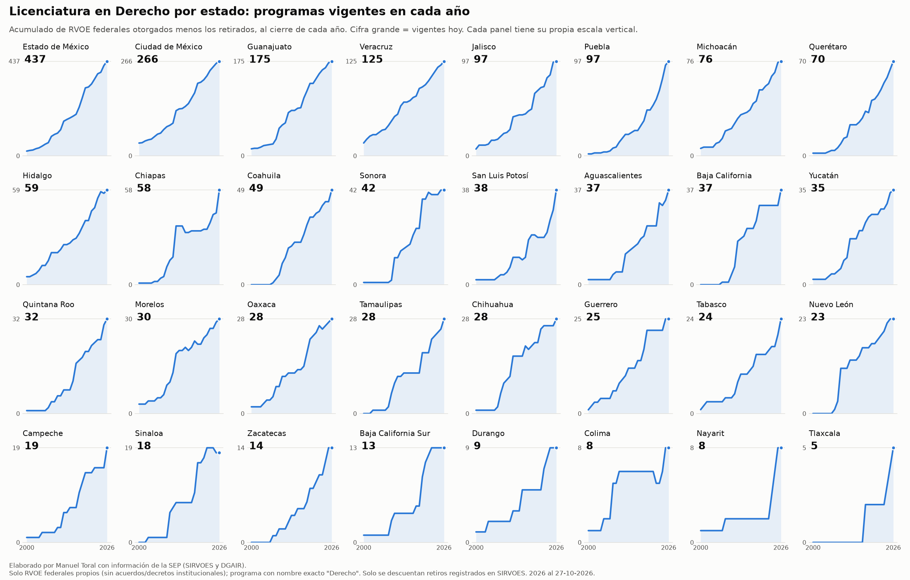
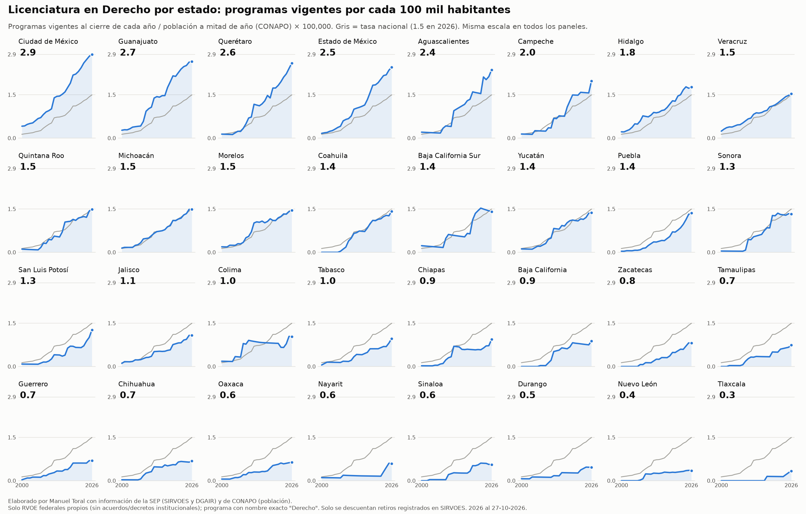
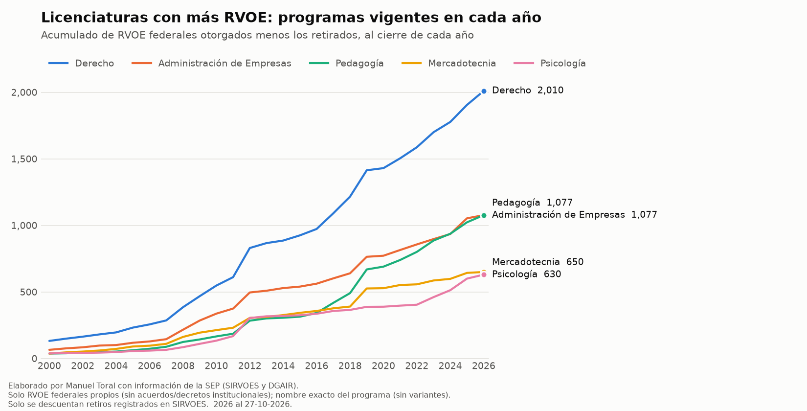
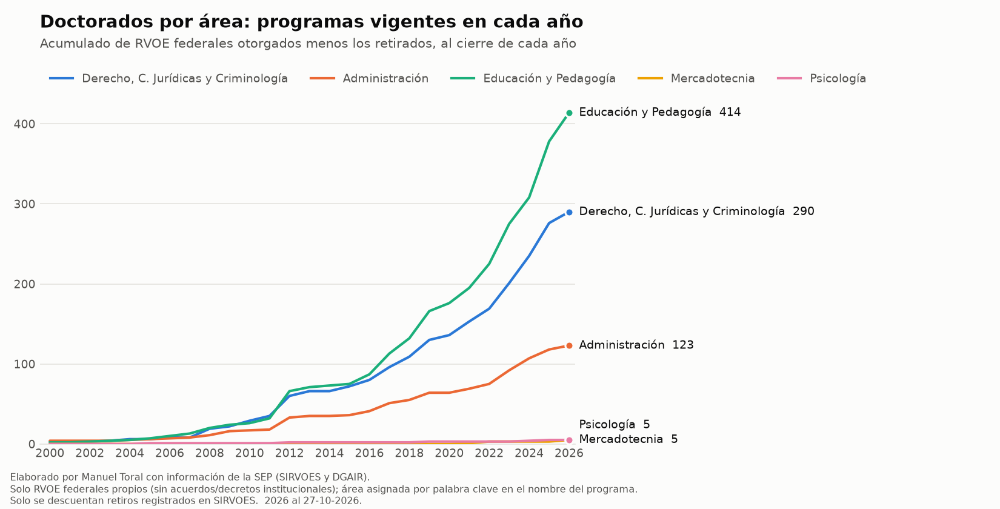
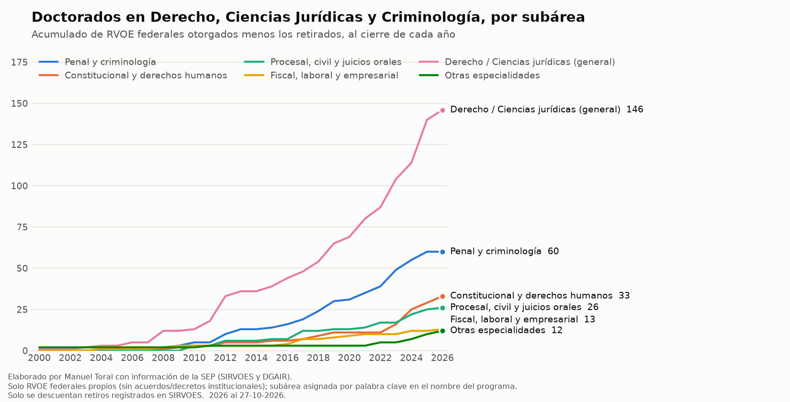
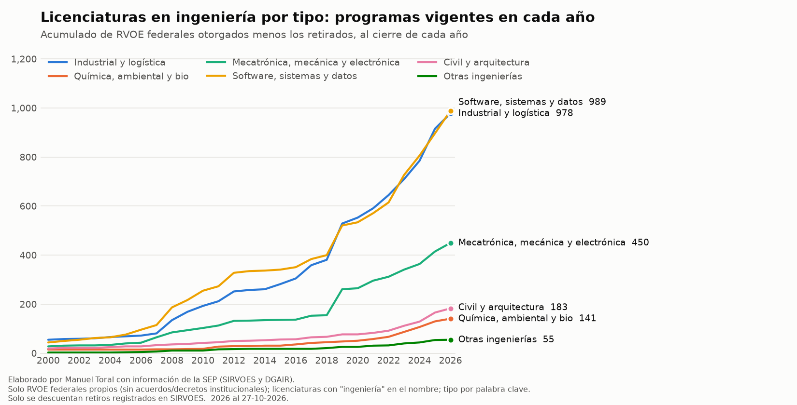

# RVOEs de educación superior en México

*Elaborado por Manuel Toral con información de la SEP (SIRVOES y DGAIR).*

Base de datos abierta de los **Reconocimientos de Validez Oficial de Estudios (RVOE) federales del tipo superior**. Se construye a partir de las dos fuentes públicas de la SEP y se cruzan entre sí.

- **46,446 programas** en la tabla unificada: 39,907 vigentes y 6,539 retirados.
- **2,470 nombres de institución** distintos con programas vigentes y **3,432 planteles** en SIRVOES.
- Corte: registros con fecha de otorgamiento hasta el **27-10-2026** (descarga del 25-11-2026).


---

## Contenido

1. [Archivos](#archivos)
2. [Fuentes](#fuentes)
3. [Qué aporta cada fuente](#qué-aporta-cada-fuente)
4. [Cómo se construye la tabla unificada](#cómo-se-construye-la-tabla-unificada)
5. [Diccionario de datos](#diccionario-de-datos)
6. [Hallazgos del cruce](#hallazgos-del-cruce)
7. [Panorama general](#panorama-general)
8. [Caso: Licenciatura en Derecho](#caso-licenciatura-en-derecho)
9. [Licenciaturas más frecuentes: vigentes por año](#licenciaturas-más-frecuentes-vigentes-por-año)
10. [Doctorados por área: vigentes por año](#doctorados-por-área-vigentes-por-año)
11. [Doctorados jurídicos por subárea](#doctorados-jurídicos-por-subárea)
12. [Ingenierías: vigentes por año](#ingenierías-vigentes-por-año)
13. [Limitaciones y advertencias](#limitaciones-y-advertencias)
14. [Reproducir](#reproducir)

---

## Archivos

| Archivo | Qué es | Filas |
|---|---|---|
| **`data/rvoes.csv`** / **`.xlsx`** | **Tabla unificada (usar esta).** Todo SIRVOES más los RVOE vigentes que solo aparecen en DGAIR | 46,446 |
| `data/rvoes_sirvoes.csv` / `.xlsx` | Todos los programas de SIRVOES, vigentes y retirados, con datos del plantel | 43,156 |
| `data/rvoes_dgair.csv` / `.xlsx` | Tablas extraídas de los 5 PDFs de federales vigentes de DGAIR | 41,342 |
| `data/cruce_dgair_sirvoes.csv` | Tabla DGAIR con el estatus que cada RVOE tiene en SIRVOES | 41,342 |
| `img/derecho_por_anio.png` | Gráfica: Derecho, RVOE otorgados por año y modalidad | — |
| `img/derecho_por_estado.png` | Gráfica: Derecho, vigentes en cada año, un panel por estado | — |
| `img/derecho_por_estado_tasa.png` | Gráfica: Derecho por cada 100 mil habitantes, un panel por estado | — |
| `img/ingenierias_acumulados.png` | Gráfica: ingenierías vigentes en cada año, por tipo | — |
| `data/poblacion_conapo.csv` | Población a mitad de año por estado, 2000–2030 (CONAPO) | 992 |
| `poblacion_conapo.py` | Descarga y resume la población de CONAPO | |
| `img/vigentes_acumulados.png` | Gráfica: programas vigentes en cada año, top 5 licenciaturas | — |
| `img/doctorados_acumulados.png` | Gráfica: doctorados vigentes en cada año, por área | — |
| `img/doctorados_derecho_subareas.png` | Gráfica: doctorados jurídicos vigentes en cada año, por subárea | — |
| `parse_dgair.py` | Extrae las tablas de los PDFs (pdfplumber) | |
| `scrape_sirvoes.py` | Descarga SIRVOES desde su API JSON | |
| `cruce.py` | Cruza ambas fuentes y genera la tabla unificada | |
| `graficas.py` | Genera las gráficas y sus tablas | |

Los CSV están en UTF-8 con BOM, así que Excel los abre con acentos correctos. Las fechas están en formato `AAAA-MM-DD`.

---

## Fuentes

### 1. DGAIR: Instituciones federales vigentes
<https://dgair.sep.gob.mx/federales_vigentes>

La Dirección General de Acreditación, Incorporación y Revalidación publica 5 PDFs ordenados alfabéticamente por institución (`A_C`, `D_H`, `I_J`, `K_T`, `U_Z`, ~1,000 páginas). Cada fila trae institución, estado, nivel, programa, modalidad y la columna `ACUERDO / RVOE Y FECHA DE OTORGAMIENTO`.

### 2. SIRVOES: Sistema de Reconocimiento de Validez Oficial de Estudios
<https://sirvoes.sep.gob.mx/sirvoes/mvc/consultas>

La interfaz web obliga a elegir un estado y pagina de 10 en 10, pero detrás hay una API JSON pública que no requiere sesión:

| Endpoint (POST, JSON) | Devuelve |
|---|---|
| `consultas/consultaGeneral` `{entidad, …, indiceInferior, indiceSuperior}` | Planteles de un estado |
| `consultas/detallesIdPlantel` `{idPlantel, indiceInferior, indiceSuperior}` | Programas de un plantel, con todos los datos del plantel e institución anidados |
| `consultas/consultaTotales`, `detallesTotales` | Conteos para la paginación |

`indiceSuperior` no está topado, así que basta 1 llamada por estado (32) y 1 por plantel (3,432). El servidor solo negocia cifrados TLS antiguos: el script baja `SECLEVEL` de OpenSSL, pero sigue verificando el certificado.

---

## Qué aporta cada fuente

| Campo | DGAIR | SIRVOES |
|---|:-:|:-:|
| Institución, estado, nivel, programa, modalidad, RVOE, fecha de otorgamiento | ✅ | ✅ |
| Plantel / campus, municipio | ❌ | ✅ |
| Domicilio, CP, teléfono, correo, página web | ❌ | ✅ |
| Razón social (persona moral) | ❌ | ✅ |
| Área de estudios | ❌ | ✅ |
| Programas **retirados**, con fecha y motivo del retiro | ❌ | ✅ |
| Grupo (clasificación de la institución), "excelencia", autorizada para equivalencias | ❌ | ✅ |
| Clave del programa en acuerdos secretariales (`ACUERDO 131/3067`) | ❌ (solo `ACUERDO 131`) | ✅ |
| RVOE otorgados en 2025–2026 | ✅ más completo | ⚠️ rezagado |

**Conclusión:** SIRVOES es mucho más rico, pero DGAIR tiene ~3,000 RVOE recientes que SIRVOES todavía no publica. Ninguna fuente contiene a la otra, por eso se usan ambas.

---

## Cómo se construye la tabla unificada

1. **Base:** todas las filas de SIRVOES (`fuente = SIRVOES`).
2. **Cruce por RVOE.** El RVOE de DGAIR se separa de su fecha (la fecha es lo último en la celda; lo anterior es el identificador) y se compara contra SIRVOES.
3. **Acuerdos secretariales.** Instituciones como UVM (`ACUERDO 131`), UNITEC (`ACUERDO 142`), Tec de Monterrey, Anáhuac o ITESO tienen en DGAIR una sola clave institucional y en SIRVOES una por programa (`ACUERDO 131/3067`). Se consideran cubiertas cuando coincide la *base* del acuerdo (lo anterior a la última `/`). Una clave numérica corta (`142`) se interpreta como `ACUERDO 142`: un RVOE real tiene 6 a 8 dígitos.
4. **Se agregan las filas de DGAIR no cubiertas** (`fuente = DGAIR`, 3,290 filas). Antes se eliminan las filas repetidas idénticas del PDF y se homologan al catálogo de SIRVOES:
   - estado: `ESTADO DE MEXICO` → `MÉXICO`, `VERACRUZ` → `VERACRUZ DE IGNACIO DE LA LLAVE`, acentos, etc.
   - nivel: `MAESTRIA` → `MAESTRÍA`, …
   - modalidad: `ESCOLAR` → `ESCOLARIZADA`
   - programa: se quita el prefijo `EN ` (`EN DERECHO` → `DERECHO`)
5. **Marcas de revisión** en la columna `nota` (ver abajo).

---

## Diccionario de datos

### `data/rvoes.csv` (tabla unificada)

Las columnas marcadas con † solo vienen de SIRVOES y están vacías en las filas con `fuente = DGAIR`. El % es la proporción de filas no vacías.

| Columna | Descripción | % lleno |
|---|---|--:|
| `fuente` | `SIRVOES` o `DGAIR` (solo en DGAIR) | 100 |
| `id_programa` † | ID interno del programa en SIRVOES; sirve para la ficha técnica: `https://sirvoes.sep.gob.mx/sirvoes/mvc/jasper/exportarFichaTecnica?idPlantelFicha=<id_programa>` | 93 |
| `llave` † | Otra clave interna de SIRVOES | 93 |
| `id_plantel` † | ID interno del plantel | 93 |
| `institucion` | Nombre de la institución | 100 |
| `razon_social` † | Persona moral titular del RVOE | 93 |
| `grupo` † | Clasificación de la institución: `SIN GRUPO`, `GRUPO 1 - EN PROCESO DE ACREDITACIÓN`, `GRUPO 2 - ACREDITADA`, `GRUPO 3 - ACREDITADA CONSOLIDADA` | 93 |
| `tipo_rvoe` † | `FEDERAL` (43,148) o `ESTATAL` (8) | 93 |
| `autorizada_equivalencias` † | `SI` / `NO`: si la institución puede otorgar equivalencias de estudio | 93 |
| `plantel` † | Nombre del plantel o campus (`SEDE`, `CAMPUS COYOACAN`…) | 93 |
| `estado` | Entidad federativa (catálogo SIRVOES) | 100 |
| `municipio` † | Municipio o alcaldía | 93 |
| `domicilio` † | Calle, número y colonia | 93 |
| `cp` † | Código postal | 93 |
| `telefono` † | Lada y teléfono | 93 |
| `correo` † | Correo del plantel o del director | 90 |
| `pagina_web` † | Sitio web (a menudo vacío) | 56 |
| `excelencia` † | `SI` / `NO`; campo de SIRVOES sin definición publicada | 51 |
| `nivel` | `LICENCIATURA`, `MAESTRÍA`, `ESPECIALIDAD`, `DOCTORADO`, `TÉCNICO SUPERIOR UNIVERSITARIO`, `PROFESIONAL ASOCIADO` | 100 |
| `programa` | Nombre del programa. **SIRVOES a veces agrega anotaciones entre paréntesis**, como `DERECHO (RETIRADO)` o `DERECHO (LICENCIATURA MIXTA)`; quítelas antes de agrupar | 100 |
| `modalidad` | `ESCOLARIZADA`, `MIXTA`, `NO ESCOLARIZADA` | 100 |
| `area` † | Área de estudios. Conviven dos catálogos: p. ej. `CIENCIAS SOCIALES Y DERECHO` y `CIENCIAS SOCIALES, ADMINISTRACIÓN Y DERECHO` | 93 |
| `rvoe` | Número de RVOE o acuerdo (`20240279`, `ACUERDO 131/3067`, `DECRETO/1952/1229`…) | 100 |
| `estatus` | `VIGENTE` o `RETIRADO` (las filas de DGAIR son todas vigentes) | 100 |
| `fecha_otorgamiento` | Fecha de otorgamiento del RVOE | 99.8 |
| `fecha_fin` † | Fecha de fin; casi nunca se llena | 0.3 |
| `fecha_retiro` † | Fecha de retiro (solo retirados) | 14 |
| `motivo_retiro` † | `A PETICIÓN DEL PARTICULAR` (6,358) o `SANCIÓN IMPUESTA POR LA AUTORIDAD EDUCATIVA` (181) | 14 |
| `en_dgair` | `True` si el RVOE (o la base de su acuerdo) aparece en los PDFs de DGAIR | 100 |
| `nota` | Advertencias, ver abajo | 0.9 |
| `archivo`, `pagina` | PDF y página de origen (solo filas DGAIR), para verificar contra la fuente | 7 |

**Valores de `nota`:**

| Valor | Filas | Significado |
|---|--:|---|
| `acuerdo/decreto con clave irregular: posible duplicado de un registro SIRVOES` | 311 | Fila DGAIR con clave mal escrita (`ACUERDO-131`, `DECRETO PRESIDENCIAL`, `OF.`…) que no se pudo cruzar. Lo más probable es que ya esté en SIRVOES; no se revisó a mano |
| `retirado en SIRVOES pero DGAIR lo lista como vigente` | 100 | Discrepancia entre fuentes |

### `data/rvoes_dgair.csv`

`institucion`, `estado`, `nivel`, `programa`, `modalidad` tal como vienen en el PDF (sin acentos, programa con prefijo `EN`). `rvoe_fecha` es la celda original; `rvoe` y `fecha_otorgamiento` se derivan de ella. `archivo` y `pagina` indican el origen. Hay 105 filas cuya fecha viene mal capturada en el propio PDF (`201-07-19`, `2018-18-16`): ahí `fecha_otorgamiento` queda vacía y se conserva el texto original.

### `data/rvoes_sirvoes.csv`

Mismas columnas que la tabla unificada, salvo `fuente`, `en_dgair`, `nota`, `archivo` y `pagina`.

### `data/cruce_dgair_sirvoes.csv`

`rvoes_dgair.csv` más `estatus_sirvoes`: `VIGENTE`, `RETIRADO`, `NO ENCONTRADO` o `NO CRUZABLE (ACUERDO/DECRETO)`.

---

## Hallazgos del cruce

Por RVOE único de DGAIR (30,573):

| Estatus en SIRVOES | RVOE |
|---|--:|
| Vigente | 27,407 |
| No encontrado (numérico) | 2,957 |
| Retirado | 100 |
| No cruzable por clave (acuerdo/decreto) | 109 |

- **SIRVOES va rezagado en lo reciente.** De los RVOE numéricos de DGAIR que no aparecen en SIRVOES, 2,051 son de 2025 y 835 de 2026.
- **DGAIR tampoco está completo.** SIRVOES tiene 2,226 RVOE numéricos vigentes que no están en los PDFs. No son solo recientes (hay de 2021 a 2024) y se concentran en el Estado de México y CDMX.
- **100 RVOE retirados en SIRVOES siguen apareciendo como vigentes en DGAIR.**
- **Los acuerdos secretariales** (UVM, Tec, UNITEC, Anáhuac, ITESO…) suman miles de programas que DGAIR agrupa bajo una sola clave institucional.

---

## Panorama general

Programas **vigentes** en la tabla unificada (39,907):

| Nivel | Programas |
|---|--:|
| Licenciatura | 24,518 |
| Maestría | 10,480 |
| Especialidad | 3,167 |
| Doctorado | 1,328 |
| Técnico Superior Universitario | 266 |
| Profesional Asociado | 148 |

| Modalidad | Programas |
|---|--:|
| Escolarizada | 20,316 |
| Mixta | 12,880 |
| No escolarizada | 6,711 |

Estados con más programas vigentes: Ciudad de México (7,550), Estado de México (6,935), Puebla (2,544), Guanajuato (2,462), Jalisco (2,321), Veracruz (2,001).

Licenciaturas vigentes más frecuentes (agrupadas por nombre, sin anotaciones):

| Programa | Programas vigentes |
|---|--:|
| Derecho | 2,149 |
| Administración de Empresas | 1,199 |
| Pedagogía | 1,125 |
| Mercadotecnia | 816 |
| Psicología | 733 |
| Contaduría Pública | 632 |
| Arquitectura | 570 |
| Administración | 547 |

Retiros: 6,539 programas retirados, 97% a petición del particular y 181 por sanción de la autoridad educativa.

---

## Caso: Licenciatura en Derecho

Se toman los programas de nivel licenciatura cuyo nombre, sin anotaciones entre paréntesis, es exactamente `DERECHO`. Quedan fuera variantes como `DERECHO Y CIENCIAS JURIDICAS` o `DERECHO CORPORATIVO`.

- **Es la licenciatura con más RVOE federales: 2,149 vigentes**, casi el doble que la segunda (Administración de Empresas) y el 8.8% de todas las licenciaturas vigentes. Otros 457 programas de Derecho ya fueron retirados.
- **Los otorgamientos llegan en oleadas:** picos en 2012 (219), 2018 (208) y sobre todo 2019 (303), seguidos de caídas abruptas (37 en 2013, 34 en 2020).
- **La modalidad cambió.** Entre 2008 y 2011, el 64% de los nuevos RVOE eran escolarizados; entre 2023 y 2026 solo el 26%. Hoy predominan las modalidades mixta y no escolarizada.
- Estados con más programas vigentes de Derecho (todos, incluidos los de acuerdo institucional): Estado de México (458), CDMX (297), Guanajuato (179), Veracruz (132), Jalisco (107), Puebla (101).

<details>
<summary>Tabla de la gráfica: RVOE de Licenciatura en Derecho otorgados por año y modalidad (vigentes + retirados)</summary>

| Año | Escolarizada | Mixta | No escolarizada | Total |
|--:|--:|--:|--:|--:|
| 2000 | 16 | 0 | 1 | 17 |
| 2001 | 13 | 3 | 1 | 17 |
| 2002 | 12 | 3 | 0 | 15 |
| 2003 | 14 | 3 | 0 | 17 |
| 2004 | 12 | 3 | 0 | 15 |
| 2005 | 25 | 11 | 0 | 36 |
| 2006 | 19 | 5 | 0 | 24 |
| 2007 | 27 | 3 | 0 | 30 |
| 2008 | 60 | 39 | 1 | 100 |
| 2009 | 59 | 24 | 0 | 83 |
| 2010 | 52 | 26 | 2 | 80 |
| 2011 | 37 | 26 | 0 | 63 |
| 2012 | 81 | 127 | 11 | 219 |
| 2013 | 17 | 19 | 1 | 37 |
| 2014 | 6 | 12 | 1 | 19 |
| 2015 | 17 | 33 | 5 | 55 |
| 2016 | 30 | 19 | 2 | 51 |
| 2017 | 76 | 58 | 12 | 146 |
| 2018 | 88 | 106 | 14 | 208 |
| 2019 | 125 | 161 | 17 | 303 |
| 2020 | 19 | 12 | 3 | 34 |
| 2021 | 51 | 55 | 14 | 120 |
| 2022 | 39 | 44 | 20 | 103 |
| 2023 | 40 | 84 | 39 | 163 |
| 2024 | 44 | 59 | 29 | 132 |
| 2025 | 43 | 66 | 46 | 155 |
| 2026* | 17 | 68 | 22 | 107 |

\* 2026 parcial, con registros hasta el 27-10-2026.
</details>

**Cómo leer la gráfica:**
- Cuenta RVOE por **fecha de otorgamiento**, incluyendo los ya retirados. No es el número de programas activos en cada año.
- **Solo se cuentan programas con RVOE propio**, en esta y en todas las series por año. Los que dependen de un acuerdo o decreto institucional (139 de los 2,149 programas de Derecho vigentes: UVM, UNITEC, Tec…) llevan la fecha del acuerdo (1988, 1952) y no la del programa, así que se excluyen.
- Solo se ven los retiros que SIRVOES registra. Si hay programas antiguos retirados que no están en el sistema, los años viejos quedan subrepresentados.

### Por estado



Una línea por estado con los programas de Derecho **vigentes al cierre de cada año** (otorgados menos retirados), ordenados de mayor a menor. **Cada panel tiene su propia escala vertical** para que se vea la forma de la curva aun en estados con pocos programas; la cifra grande es el número de vigentes hoy y la marca superior del eje es el máximo del estado.

- **Estado de México y CDMX concentran el 35%** de los programas vigentes de Derecho con RVOE propio (437 y 266 de 2,010).
- **Puebla es el que más se aceleró recientemente:** se duplicó de 2020 a 2026 (de 47 a 97).
- **Chiapas** creció de golpe en 2012, se mantuvo estable casi una década y volvió a crecer desde 2023.
- **Solo Sinaloa tiene hoy menos programas que en su máximo** (19 → 18).
- **Tlaxcala** no tuvo ningún RVOE federal de Derecho hasta 2017 y hoy tiene 5. Es probable que la mayor parte de la oferta de algunos estados esté en RVOE estatales, que esta base no incluye.

<details>
<summary>Tabla: programas de Derecho vigentes al cierre de años seleccionados, por estado</summary>

| Estado | 2000 | 2010 | 2020 | 2026* | Máximo |
|---|--:|--:|--:|--:|--:|
| Estado de México | 22 | 105 | 318 | 437 | 437 |
| Ciudad de México | 36 | 86 | 207 | 266 | 266 |
| Guanajuato | 13 | 57 | 134 | 175 | 175 |
| Veracruz | 17 | 52 | 94 | 125 | 125 |
| Jalisco | 7 | 24 | 67 | 97 | 97 |
| Puebla | 2 | 14 | 47 | 97 | 97 |
| Michoacán | 6 | 22 | 53 | 76 | 76 |
| Querétaro | 2 | 13 | 42 | 70 | 70 |
| Hidalgo | 5 | 20 | 40 | 59 | 59 |
| Chiapas | 1 | 15 | 33 | 58 | 58 |
| Coahuila | 0 | 11 | 35 | 49 | 49 |
| Sonora | 1 | 12 | 38 | 42 | 42 |
| San Luis Potosí | 2 | 5 | 19 | 38 | 38 |
| Aguascalientes | 2 | 5 | 23 | 37 | 37 |
| Baja California | 0 | 4 | 31 | 37 | 37 |
| Yucatán | 2 | 9 | 26 | 35 | 35 |
| Quintana Roo | 1 | 6 | 21 | 32 | 32 |
| Morelos | 3 | 10 | 22 | 30 | 30 |
| Oaxaca | 2 | 11 | 23 | 28 | 28 |
| Tamaulipas | 0 | 9 | 18 | 28 | 28 |
| Chihuahua | 1 | 10 | 21 | 28 | 28 |
| Guerrero | 1 | 8 | 22 | 25 | 25 |
| Tabasco | 1 | 4 | 15 | 24 | 24 |
| Nuevo León | 0 | 11 | 17 | 23 | 23 |
| Campeche | 1 | 3 | 14 | 19 | 19 |
| Sinaloa | 0 | 6 | 16 | 18 | 19 |
| Zacatecas | 0 | 2 | 8 | 14 | 14 |
| Baja California Sur | 1 | 4 | 11 | 13 | 13 |
| Durango | 1 | 2 | 5 | 9 | 9 |
| Colima | 1 | 6 | 6 | 8 | 8 |
| Nayarit | 1 | 2 | 2 | 8 | 8 |
| Tlaxcala | 0 | 0 | 2 | 5 | 5 |

\* 2026 parcial, con registros hasta el 27-10-2026. La serie completa año por año la imprime `python graficas.py`.
</details>

### Por estado, por cada 100 mil habitantes



Es la misma serie dividida entre la **población a mitad de año de cada estado** (CONAPO: Conciliación Demográfica 1950–2019 y Proyecciones 2020–2070, edición 2023) y multiplicada por 100,000. Aquí **todos los paneles comparten escala**, porque las tasas sí son comparables entre estados. La línea gris es la tasa nacional.

- **A escala nacional hay 1.5 programas de Derecho vigentes por cada 100 mil habitantes**, más de diez veces la tasa de 2000 (0.13).
- **Ajustando por población, el mapa cambia.** Ciudad de México sigue primero (2.9), pero le siguen **Guanajuato (2.7) y Querétaro (2.6)**, por encima del Estado de México (2.5), que en números absolutos es el primero. Aguascalientes (2.4) va muy cerca.
- **Jalisco (1.1) y Nuevo León (0.35) quedan muy por debajo del promedio** pese a ser estados grandes; Nuevo León es el penúltimo del país.
- **Campeche (2.0)** aparece alto por tener poca población: 19 programas.
- En Tamaulipas, Guerrero, Chihuahua, Oaxaca, Nayarit, Sinaloa, Durango, Nuevo León y Tlaxcala la tasa está por debajo de la mitad de la nacional (0.75).
- Como en las demás series, solo se cuentan programas con RVOE propio (ver *Limitaciones*).

<details>
<summary>Tabla: programas de Derecho vigentes por cada 100 mil habitantes, por estado</summary>

| Estado | 2000 | 2010 | 2020 | 2026* | Programas 2026 | Población 2026 |
|---|--:|--:|--:|--:|--:|--:|
| Ciudad de México | 0.41 | 0.95 | 2.22 | 2.90 | 266 | 9,159,966 |
| Guanajuato | 0.27 | 1.02 | 2.14 | 2.66 | 175 | 6,590,749 |
| Querétaro | 0.14 | 0.70 | 1.74 | 2.59 | 70 | 2,700,978 |
| Estado de México | 0.17 | 0.68 | 1.84 | 2.45 | 437 | 17,822,420 |
| Aguascalientes | 0.21 | 0.41 | 1.58 | 2.36 | 37 | 1,567,559 |
| Campeche | 0.14 | 0.36 | 1.49 | 1.98 | 19 | 962,014 |
| Hidalgo | 0.22 | 0.74 | 1.28 | 1.77 | 59 | 3,334,060 |
| Veracruz | 0.24 | 0.67 | 1.15 | 1.54 | 125 | 8,111,813 |
| Quintana Roo | 0.11 | 0.45 | 1.11 | 1.49 | 32 | 2,141,082 |
| Michoacán | 0.15 | 0.49 | 1.10 | 1.49 | 76 | 5,089,383 |
| Morelos | 0.19 | 0.55 | 1.10 | 1.45 | 30 | 2,067,472 |
| Coahuila | 0.00 | 0.39 | 1.09 | 1.42 | 49 | 3,440,385 |
| Baja California Sur | 0.23 | 0.62 | 1.35 | 1.41 | 13 | 921,734 |
| Yucatán | 0.12 | 0.45 | 1.10 | 1.38 | 35 | 2,542,536 |
| Puebla | 0.04 | 0.24 | 0.70 | 1.36 | 97 | 7,149,139 |
| Sonora | 0.04 | 0.44 | 1.27 | 1.33 | 42 | 3,168,624 |
| San Luis Potosí | 0.08 | 0.19 | 0.66 | 1.27 | 38 | 3,002,651 |
| Jalisco | 0.11 | 0.32 | 0.79 | 1.08 | 97 | 8,982,027 |
| Colima | 0.18 | 0.91 | 0.81 | 1.04 | 8 | 771,538 |
| Tabasco | 0.05 | 0.18 | 0.61 | 0.97 | 24 | 2,472,668 |
| Chiapas | 0.03 | 0.30 | 0.58 | 0.94 | 58 | 6,185,469 |
| Baja California | 0.00 | 0.13 | 0.81 | 0.88 | 37 | 4,189,285 |
| Zacatecas | 0.00 | 0.13 | 0.49 | 0.81 | 14 | 1,726,898 |
| Tamaulipas | 0.00 | 0.27 | 0.50 | 0.74 | 28 | 3,777,472 |
| Guerrero | 0.03 | 0.23 | 0.61 | 0.69 | 25 | 3,606,296 |
| Chihuahua | 0.03 | 0.29 | 0.55 | 0.69 | 28 | 4,087,306 |
| Oaxaca | 0.06 | 0.28 | 0.55 | 0.64 | 28 | 4,368,997 |
| Nayarit | 0.11 | 0.18 | 0.16 | 0.60 | 8 | 1,338,499 |
| Sinaloa | 0.00 | 0.21 | 0.52 | 0.56 | 18 | 3,208,039 |
| Durango | 0.07 | 0.12 | 0.27 | 0.46 | 9 | 1,939,482 |
| Nuevo León | 0.00 | 0.23 | 0.29 | 0.35 | 23 | 6,516,202 |
| Tlaxcala | 0.00 | 0.00 | 0.15 | 0.34 | 5 | 1,464,515 |
| **Nacional** | **0.13** | **0.48** | **1.12** | **1.50** | **2,010** | **134,407,258** |

\* 2026 parcial, con registros hasta el 27-10-2026. Población: CONAPO, población a mitad de año (`data/poblacion_conapo.csv`, generado con `poblacion_conapo.py`).
</details>

---

## Licenciaturas más frecuentes: vigentes por año



Para cada año se cuentan los programas **vigentes al cierre de ese año**: RVOE otorgados hasta ese año menos los retirados hasta ese año (según `fecha_retiro`). Se toman las 5 licenciaturas con más RVOE vigentes hoy, por nombre exacto del programa.

- **Derecho siempre fue la primera y la brecha se ensancha:** 132 programas en 2000 y 2,010 hoy (15 veces más). Le saca más de 900 a la segunda.
- **Pedagogía es la que más creció:** de 37 programas en 2000 a 1,077 hoy (29 veces). Rebasó para siempre a Psicología en 2016 y a Mercadotecnia en 2017, alcanzó a Administración de Empresas en 2024 y hoy están empatadas (1,077 cada una).
- **Mercadotecnia y Psicología van atrás y casi juntas** (650 y 630). Psicología se aceleró desde 2023: pasó de 404 a 630 programas en cuatro años.
- **Las curvas nunca bajan:** en ningún año los retiros superaron a los nuevos otorgamientos. Los saltos de 2012 y 2019 coinciden con las oleadas de la gráfica de Derecho.

<details>
<summary>Tabla de la gráfica: programas vigentes al cierre de cada año</summary>

| Año | Derecho | Administración de Empresas | Pedagogía | Mercadotecnia | Psicología |
|--:|--:|--:|--:|--:|--:|
| 2000 | 132 | 65 | 37 | 37 | 38 |
| 2001 | 149 | 76 | 39 | 46 | 40 |
| 2002 | 164 | 84 | 44 | 52 | 42 |
| 2003 | 181 | 97 | 47 | 60 | 44 |
| 2004 | 196 | 101 | 52 | 72 | 48 |
| 2005 | 232 | 118 | 62 | 90 | 56 |
| 2006 | 256 | 128 | 73 | 96 | 59 |
| 2007 | 286 | 145 | 88 | 110 | 65 |
| 2008 | 385 | 216 | 124 | 162 | 85 |
| 2009 | 468 | 285 | 143 | 194 | 110 |
| 2010 | 548 | 337 | 166 | 213 | 134 |
| 2011 | 611 | 375 | 186 | 231 | 168 |
| 2012 | 830 | 496 | 284 | 305 | 304 |
| 2013 | 867 | 509 | 301 | 312 | 317 |
| 2014 | 886 | 529 | 306 | 326 | 319 |
| 2015 | 925 | 540 | 314 | 343 | 325 |
| 2016 | 973 | 562 | 342 | 357 | 336 |
| 2017 | 1,091 | 602 | 418 | 377 | 357 |
| 2018 | 1,216 | 640 | 491 | 390 | 365 |
| 2019 | 1,414 | 764 | 669 | 526 | 388 |
| 2020 | 1,430 | 772 | 690 | 528 | 389 |
| 2021 | 1,504 | 815 | 740 | 552 | 397 |
| 2022 | 1,587 | 857 | 801 | 557 | 404 |
| 2023 | 1,700 | 897 | 886 | 586 | 461 |
| 2024 | 1,777 | 935 | 937 | 598 | 513 |
| 2025 | 1,905 | 1,053 | 1,023 | 643 | 600 |
| 2026* | 2,010 | 1,077 | 1,077 | 650 | 630 |

\* 2026 parcial, con registros hasta el 27-10-2026.
</details>

**Cómo leer la gráfica:**
- Es una reconstrucción a partir de lo que hoy publica la SEP: un programa retirado que SIRVOES ya no registra no aparece en ningún año, así que los años antiguos pueden estar subestimados.
- Se usa el nombre exacto del programa. `ADMINISTRACION` (547 vigentes) va por separado de `ADMINISTRACION DE EMPRESAS`, y quedan fuera variantes como `DERECHO Y CIENCIAS JURIDICAS`.
- Un RVOE vigente no significa que el programa tenga alumnos inscritos.
- Solo se cuentan programas con RVOE propio: quedan fuera 139 programas de Derecho vigentes que dependen de un acuerdo institucional (la serie llega a 2,010 de 2,149).

---

## Doctorados por área: vigentes por año



Es el mismo cálculo que la gráfica anterior (otorgados menos retirados al cierre de cada año), pero para programas de **doctorado** en las mismas áreas. En doctorado los nombres varían mucho (`DERECHO PENAL`, `CIENCIAS DE LA EDUCACION`, `ADMINISTRACION PUBLICA`), así que el área se asigna **por palabra clave en el nombre del programa**. Gana la primera regla que coincide:

| Área | Palabras clave | Ejemplos |
|---|---|---|
| Derecho, C. Jurídicas y Criminología | `DERECHO`, `JURIDIC`, `CRIMIN`, `PENAL`, `JUICIO`, `FORENS`, `SEGURIDAD PUBLICA`, `JUSTICIA` | Derecho, Derecho Penal, Ciencias Jurídicas, Criminología, Política Criminal, Ciencias Penales, Juicios Orales, Ciencias Forenses, Seguridad Pública |
| Educación y Pedagogía | `EDUCACI`, `PEDAGOG`, `EDUCATIV` | Educación, Ciencias de la Educación, Innovación Educativa, Innovación y Administración Educativa |
| Administración | `ADMINISTRACI` | Administración, Administración Pública, Ciencias de la Administración |
| Mercadotecnia | `MERCADOTECNIA`, `MARKETING` | Mercadotecnia Estratégica, Dirección y Mercadotecnia |
| Psicología | `PSICOLOG` | Psicología, Investigación Psicológica |

- **Educación domina los doctorados:** 414 programas vigentes con RVOE propio, y junto con Derecho, Ciencias Jurídicas y Criminología (290) suman más de la mitad de los 1,181 doctorados vigentes con RVOE propio.
- **Casi todos son de los últimos 15 años.** En 2000 había apenas 2 doctorados de Educación y 3 del área jurídica con RVOE propio; el despegue empieza en 2008 y se acelera desde 2012.
- **Buena parte del crecimiento es reciente.** De 2021 a 2026, Educación se duplicó con creces (de 195 a 414 programas) y el área jurídica casi (de 153 a 290).
- **Administración iba a la par del área jurídica hasta 2007**; hoy tiene menos de la mitad (123 contra 290).
- **En Mercadotecnia y Psicología casi no hay doctorados** (5 cada una), aunque estén entre las licenciaturas más frecuentes.

<details>
<summary>Tabla de la gráfica: doctorados vigentes al cierre de cada año, por área</summary>

| Año | Derecho, C. Jurídicas y Criminología | Administración | Educación y Pedagogía | Mercadotecnia | Psicología |
|--:|--:|--:|--:|--:|--:|
| 2000 | 3 | 4 | 2 | 0 | 0 |
| 2001 | 3 | 4 | 2 | 0 | 0 |
| 2002 | 3 | 4 | 3 | 0 | 0 |
| 2003 | 4 | 4 | 4 | 0 | 0 |
| 2004 | 6 | 5 | 5 | 0 | 0 |
| 2005 | 6 | 6 | 7 | 0 | 1 |
| 2006 | 8 | 7 | 10 | 0 | 1 |
| 2007 | 8 | 8 | 13 | 0 | 1 |
| 2008 | 19 | 11 | 20 | 0 | 1 |
| 2009 | 22 | 16 | 24 | 0 | 1 |
| 2010 | 29 | 17 | 26 | 0 | 1 |
| 2011 | 35 | 18 | 32 | 0 | 1 |
| 2012 | 60 | 33 | 66 | 0 | 2 |
| 2013 | 66 | 35 | 71 | 0 | 2 |
| 2014 | 66 | 35 | 73 | 0 | 2 |
| 2015 | 72 | 36 | 75 | 0 | 2 |
| 2016 | 80 | 41 | 87 | 0 | 2 |
| 2017 | 96 | 51 | 113 | 0 | 2 |
| 2018 | 109 | 55 | 132 | 0 | 2 |
| 2019 | 130 | 64 | 166 | 0 | 3 |
| 2020 | 136 | 64 | 176 | 0 | 3 |
| 2021 | 153 | 69 | 195 | 1 | 3 |
| 2022 | 169 | 75 | 225 | 3 | 3 |
| 2023 | 201 | 92 | 275 | 3 | 3 |
| 2024 | 235 | 107 | 308 | 3 | 4 |
| 2025 | 276 | 118 | 378 | 3 | 5 |
| 2026* | 290 | 123 | 414 | 5 | 5 |

\* 2026 parcial, con registros hasta el 27-10-2026.
</details>

**Cómo leer la gráfica:**
- Aplican las mismas advertencias que en la gráfica de licenciaturas.
- La clasificación por palabra clave es aproximada: un doctorado en "Gestión de Instituciones" que no use ninguna de las palabras clave no cuenta, aunque sea del área educativa.
- Las áreas de doctorado no equivalen a las carreras de licenciatura: aquí "Administración" incluye la pública y "Educación" incluye todo lo educativo, no solo Pedagogía.
- Quedan fuera del área jurídica los doctorados fiscales que no dicen "Derecho" (`CIENCIAS DE LO FISCAL`, `ESTUDIOS FISCALES`), que son más contables, y los de ciberseguridad.

---

## Doctorados jurídicos por subárea



Desglose de los 290 doctorados vigentes con RVOE propio del área jurídica (Derecho, Ciencias Jurídicas y Criminología) de la gráfica anterior. Usa el mismo cálculo: vigentes al cierre de cada año. La subárea se asigna por palabra clave y gana la primera regla que coincide, así que `DERECHO PROCESAL PENAL` cuenta como Penal y `DERECHO PROCESAL CONSTITUCIONAL` como Constitucional.

| Subárea | Palabras clave | Programas más frecuentes | Vigentes 2026 (RVOE propio) |
|---|---|---|--:|
| Penal y criminología | `PENAL`, `CRIMIN`, `FORENS`, `SEGURIDAD PUBLICA` | Derecho Penal, Seguridad Pública, Criminología, Ciencias Forenses, Derecho Procesal Penal, Política Criminal | 60 |
| Constitucional y derechos humanos | `CONSTITU`, `HUMANOS`, `AMPARO`, `PUBLICO`, `ANTICORRUP` | Derechos Humanos, Derecho Público, Derecho Constitucional, Constitucional y Amparo | 33 |
| Procesal, civil y juicios orales | `PROCESAL`, `CIVIL`, `FAMILIAR`, `JUICIO`, `ORAL`, `LITIG` | Derecho Civil, Derecho Procesal, Derecho y Procedimientos Orales, Civil con Juicio Oral | 26 |
| Fiscal, laboral y empresarial | `FISCAL`, `TRIBUT`, `LABORAL`, `TRABAJO`, `CORPORAT`, `EMPRESA`, `COMERCI`, `ADUAN`, `MARITIM` | Derecho Fiscal, Derecho Laboral, Aduanero y Comercio Exterior | 13 |
| Derecho / Ciencias jurídicas (general) | nombre exacto: `DERECHO`, `CIENCIAS JURIDICAS`, `DERECHO Y CIENCIAS JURIDICAS`, `INVESTIGACION JURIDICA` | Derecho, Ciencias Jurídicas, Derecho y Ciencias Jurídicas | 146 |
| Otras especialidades | lo que no entra en las anteriores | Filosofía del Derecho, Marco Jurídico de Gestión de Riesgos, Ciencias Jurídicas, Política y Gobierno, Derecho Sanitario | 12 |

- **La mitad son doctorados genéricos "en Derecho"** (146 de 290). Las especialidades crecen, pero el título general sigue siendo el más común.
- **Penal y criminología es la especialidad más grande** (60 programas, uno de cada cinco). No existía antes de 2008 y creció de forma sostenida desde entonces.
- **Constitucional y derechos humanos es lo que más crece en los últimos años:** se triplicó de 2022 (11) a 2026 (33).
- **Antes de 2008 casi no había doctorados jurídicos especializados:** en 2007, 5 de los 8 programas eran genéricos.

<details>
<summary>Tabla de la gráfica: doctorados jurídicos vigentes al cierre de cada año, por subárea</summary>

| Año | Penal y criminología | Constitucional y DD. HH. | Procesal, civil y juicios orales | Fiscal, laboral y empresarial | General | Otras |
|--:|--:|--:|--:|--:|--:|--:|
| 2000 | 0 | 0 | 0 | 0 | 1 | 2 |
| 2001 | 0 | 0 | 0 | 0 | 1 | 2 |
| 2002 | 0 | 0 | 0 | 0 | 1 | 2 |
| 2003 | 0 | 0 | 0 | 0 | 2 | 2 |
| 2004 | 0 | 0 | 0 | 1 | 3 | 2 |
| 2005 | 0 | 0 | 0 | 1 | 3 | 2 |
| 2006 | 0 | 0 | 0 | 1 | 5 | 2 |
| 2007 | 0 | 0 | 0 | 1 | 5 | 2 |
| 2008 | 2 | 1 | 0 | 2 | 12 | 2 |
| 2009 | 3 | 2 | 0 | 3 | 12 | 2 |
| 2010 | 5 | 3 | 3 | 3 | 13 | 2 |
| 2011 | 5 | 3 | 3 | 3 | 18 | 3 |
| 2012 | 10 | 5 | 6 | 3 | 33 | 3 |
| 2013 | 13 | 5 | 6 | 3 | 36 | 3 |
| 2014 | 13 | 5 | 6 | 3 | 36 | 3 |
| 2015 | 14 | 6 | 7 | 3 | 39 | 3 |
| 2016 | 16 | 6 | 7 | 4 | 44 | 3 |
| 2017 | 19 | 7 | 12 | 7 | 48 | 3 |
| 2018 | 24 | 9 | 12 | 7 | 54 | 3 |
| 2019 | 30 | 11 | 13 | 8 | 65 | 3 |
| 2020 | 31 | 11 | 13 | 9 | 69 | 3 |
| 2021 | 35 | 11 | 14 | 10 | 80 | 3 |
| 2022 | 39 | 11 | 17 | 10 | 87 | 5 |
| 2023 | 49 | 16 | 17 | 10 | 104 | 5 |
| 2024 | 55 | 25 | 22 | 12 | 114 | 7 |
| 2025 | 60 | 29 | 25 | 12 | 140 | 10 |
| 2026* | 60 | 33 | 26 | 13 | 146 | 12 |

\* 2026 parcial, con registros hasta el 27-10-2026.
</details>

**Cómo leer la gráfica:**
- Aplican las mismas advertencias que en las gráficas anteriores. Las subáreas suman el total del área jurídica (290 en 2026).
- Un programa con nombre mixto cae en la primera regla que coincide: por ejemplo, "Juicio Oral Penal y Derechos Humanos" cuenta como Penal.

---

## Ingenierías: vigentes por año



Licenciaturas con "ingeniería" o "ingeniero" en el nombre (3,814 vigentes), agrupadas en seis tipos por palabra clave. Mismo cálculo que las demás series: vigentes al cierre de cada año, otorgados menos retirados.

**Solo se cuentan programas con RVOE propio.** 1,018 de las 3,814 ingenierías vigentes (27%) pertenecen a instituciones con acuerdo o decreto institucional: Tec de Monterrey (decreto de 1952), UVM (acuerdo 131 de 1988), UNITEC, Anáhuac, ITESO… Esos programas llevan la fecha del acuerdo y no la de su creación, así que, si se incluyeran, aparecerían como existentes desde 1952 o 1988. Sin el filtro, el 86% de las ingenierías "vigentes en 2000" serían de este tipo.

| Tipo | Palabras clave | Programas más frecuentes (vigentes) |
|---|---|---|
| Industrial y logística | `INDUSTRIAL`, `LOGISTIC`, `SUMINISTRO`, `GESTION EMPRESARIAL`, `NEGOCIOS`, `PRODUCCION` | Industrial; Industrial y de Sistemas; Industrial en Producción; Industrial y Logística |
| Química, ambiental y bio | `QUIMIC`, `AMBIENTAL`, `BIO`, `ALIMENT`, `ENERG`, `SUSTENTAB`, `AGRO`, `PETROLE`, `MINER`, `GEOL` | Química; Ambiental; Químico Administrador; Biomédica; Energías Renovables |
| Mecatrónica, mecánica y electrónica | `MECATRON`, `MECANIC`, `ROBOT`, `ELECTR`, `AUTOMOTRIZ`, `MANUFACTURA`, `AERO`, `AUTOMATIZ`, `SEMICONDUCT` | Mecatrónica; Manufactura y Robótica; Mecánica Automotriz; Sistemas Electrónicos |
| Software, sistemas y datos | `COMPUTACI`, `SOFTWARE`, `SISTEMAS`, `INFORMATIC`, `INFORMACION`, `DATOS`, `INTELIGENCIA`, `CIBER`, `REDES`, `TELECOMUNICAC`, … | Sistemas Computacionales; Desarrollo de Software; Ciberseguridad; Ciencia de Datos; Inteligencia Artificial |
| Civil y arquitectura | `CIVIL`, `ARQUITECT`, `CONSTRUC`, `TOPOGRAF` | Civil; Ingeniero Arquitecto; Construcción |
| Otras ingenierías | lo que no entra en las anteriores | Comercial, Financiera, Audio, Nanotecnología, Física, Matemáticas |

Gana la primera regla que coincide, así que "Industrial y de Sistemas" cuenta como Industrial, "Químico y de Sistemas" como Química y "Sistemas Electrónicos" como Electrónica.

- **Software y sistemas e Industrial van empatados y dominan:** 989 y 978 programas con RVOE propio en 2026. Software fue el primero casi todo el periodo; Industrial lo rebasó entre 2019 y 2022 y Software recuperó el primer lugar en 2023.
- **Mecatrónica, mecánica y electrónica es la tercera (450)**, con un salto en 2019 (de 155 a 261).
- **Química, ambiental y bio es la que más se aceleró recientemente:** se duplicó de 2022 (67) a 2026 (141). Civil y arquitectura también se duplicó (de 92 a 183).
- **Las ingenierías mantienen su peso:** entre los programas con RVOE propio, son entre el 12% y el 13.5% de todas las licenciaturas vigentes a lo largo del periodo (12.9% en 2000, 13.5% en 2026).

<details>
<summary>Tabla de la gráfica: ingenierías con RVOE propio vigentes al cierre de cada año, por tipo</summary>

| Año | Industrial y logística | Software, sistemas y datos | Mecatrónica, mecánica y electrónica | Civil y arquitectura | Química, ambiental y bio | Otras |
|--:|--:|--:|--:|--:|--:|--:|
| 2000 | 55 | 44 | 28 | 19 | 15 | 3 |
| 2001 | 58 | 50 | 31 | 22 | 15 | 3 |
| 2002 | 59 | 55 | 32 | 22 | 15 | 3 |
| 2003 | 61 | 62 | 32 | 22 | 15 | 3 |
| 2004 | 66 | 65 | 34 | 25 | 15 | 3 |
| 2005 | 69 | 76 | 40 | 28 | 15 | 4 |
| 2006 | 72 | 96 | 43 | 28 | 15 | 5 |
| 2007 | 81 | 115 | 65 | 33 | 16 | 7 |
| 2008 | 135 | 187 | 85 | 36 | 16 | 11 |
| 2009 | 169 | 217 | 94 | 38 | 17 | 11 |
| 2010 | 193 | 255 | 103 | 42 | 18 | 11 |
| 2011 | 212 | 273 | 113 | 45 | 27 | 16 |
| 2012 | 252 | 328 | 132 | 50 | 29 | 17 |
| 2013 | 258 | 335 | 133 | 51 | 29 | 18 |
| 2014 | 261 | 337 | 135 | 53 | 31 | 18 |
| 2015 | 282 | 341 | 136 | 56 | 31 | 18 |
| 2016 | 305 | 351 | 137 | 57 | 36 | 18 |
| 2017 | 359 | 384 | 153 | 65 | 42 | 18 |
| 2018 | 381 | 400 | 155 | 67 | 45 | 21 |
| 2019 | 529 | 521 | 261 | 77 | 48 | 26 |
| 2020 | 553 | 534 | 265 | 77 | 51 | 26 |
| 2021 | 591 | 571 | 296 | 83 | 58 | 31 |
| 2022 | 645 | 615 | 312 | 92 | 67 | 32 |
| 2023 | 710 | 727 | 341 | 112 | 87 | 40 |
| 2024 | 785 | 806 | 364 | 129 | 107 | 44 |
| 2025 | 916 | 897 | 415 | 166 | 130 | 54 |
| 2026* | 978 | 989 | 450 | 183 | 141 | 55 |

\* 2026 parcial, con registros hasta el 27-10-2026.
</details>

---

## Limitaciones y advertencias

- **Solo RVOE federales (SEP).** No incluye los RVOE otorgados por las autoridades educativas estatales ni los estudios incorporados a universidades públicas autónomas. SIRVOES dice incluirlos, pero en la práctica solo devuelve 8 registros estatales.
- **SIRVOES es informativo.** La propia SEP lo aclara: ante cualquier inconsistencia, la autoridad educativa correspondiente es la que tiene la última palabra.
- **Un RVOE no es un programa en operación.** Un programa vigente puede no tener matrícula.
- **El nombre del programa no está normalizado**: SIRVOES le agrega anotaciones entre paréntesis y DGAIR antepone `EN`. Para agrupar por carrera hay que limpiarlo, como en `graficas.py`.
- **Instituciones con acuerdo secretarial o decreto:** su `fecha_otorgamiento` es la del acuerdo institucional (1952 para el Tec, 1988 para UVM), no la del programa. Por eso **todas las series por año cuentan solo programas con RVOE propio** (número de RVOE numérico): los demás aparecerían como existentes desde la fecha del acuerdo aunque se hayan abierto después. Quedan fuera 7,306 programas vigentes (3,834 licenciaturas, 2,499 maestrías, 713 especialidades, 147 doctorados y 113 de TSU o profesional asociado), concentrados en el Tec, UVM, UNITEC, Anáhuac e ITESO. Las cifras de vigentes *hoy* del panorama general y del caso Derecho sí los incluyen.
- **Las 3,290 filas que solo vienen de DGAIR** no tienen plantel, municipio, contacto ni área. El nombre de institución en DGAIR a veces incluye el campus (`UNIVERSIDAD DEL VALLE DE MEXICO, CAMPUS COYOACAN`) y en SIRVOES va separado en `institucion` y `plantel`.
- **Datos de contacto:** se publican tal como los difunde la SEP. Algunos correos son de directores o cuentas personales.
- **Extracción de PDFs:** 105 filas tienen la fecha mal capturada en el original y algunas filas aparecen repetidas en el propio PDF.

---

## Reproducir

Requiere Python 3.10+.

```powershell
pip install -r requirements.txt
```

**1. PDFs de DGAIR** (~12 min de extracción):

```powershell
mkdir data/pdfs
foreach ($f in "A_C","D_H","I_J","K_T","U_Z") { curl.exe -sL -o "data/pdfs/inst_fed_vig_$f.pdf" "https://dgair.sep.gob.mx/storage/recursos/DREOE/inst_fed_vig_$f.pdf" }
python parse_dgair.py data/pdfs
```

**2. SIRVOES** (~30 min). Es reanudable: guarda el JSON crudo de cada plantel en `data/sirvoes_raw/` y no lo vuelve a pedir:

```powershell
python scrape_sirvoes.py
```

**3. Cruce y tabla unificada:**

```powershell
python cruce.py
```

**4. Población de CONAPO** (descarga ~80 MB a `data/conapo/`, no versionado; el CSV resultante sí está en el repo):

```powershell
python poblacion_conapo.py
```

**5. Gráficas** (imprimen también sus tablas en markdown):

```powershell
python graficas.py
```

Los PDFs y el JSON crudo no se versionan (`.gitignore`).
